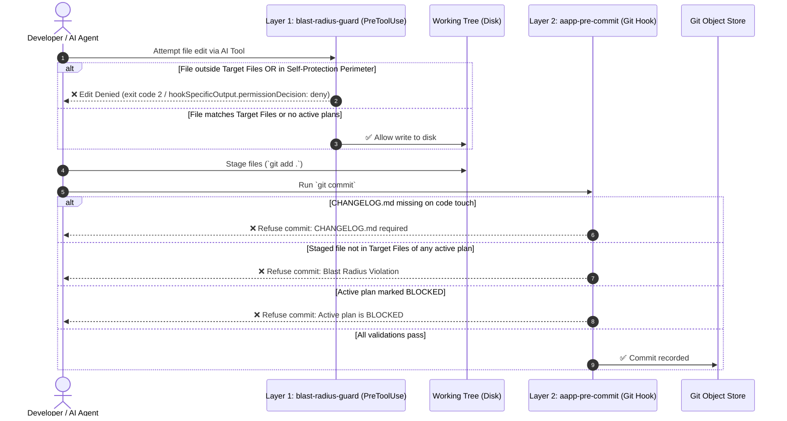

# 🛡️ Dual-Layer Blast Radius Enforcement Engine

AAPP provides deterministic safety by enforcing boundaries at two distinct moments in the development lifecycle:



---

## Layer 1: Write-Time PreToolUse Guard (`blast-radius-guard`)

Located at `.githooks/blast-radius-guard`, this executable intercepts AI tool calls before disk writes occur (e.g. Claude Code's `PreToolUse` hook across `Write`, `Edit`, `MultiEdit`, `NotebookEdit`).

### Evaluation Order & Engine Pipeline:
1. **Input Parsing & Canonicalization**: Standardizes paths using zero-dependency POSIX lexical resolution, collapsing `.` and `..` without dereferencing symlinks to close path traversal escapes while preserving dual-path inode protection.
2. **Section 2 — Self-Protection Perimeter**: AI tools are strictly forbidden from modifying enforcement configuration and governance skills:
   - `.githooks/*`, `.git/hooks/*`, `.git/config`
   - `.claude/settings.json`, `.agents/claude/*`
   - `.agents/skills/aapp-*`, `.claude/skills/aapp-*`
   - `.cursor/rules/*`
3. **Section 2b — External Hard-Deny**: Inviolable credentials, shell startup files, and system binaries are blocked regardless of allowlist breadth:
   - Credentials & keys: `~/.ssh/*`, `~/.gnupg/*`, `~/.aws/*`, `~/.azure/*`, `~/.kube/*`, `~/.docker/config.json`, `~/.netrc`, `~/.npmrc`, `~/.pypirc`, `~/.git-credentials`
   - Git configs: `~/.gitconfig`, `~/.config/git/*`
   - Shell profiles & rc files: `~/.bashrc`, `~/.bash_profile`, `~/.zshrc`, `~/.zprofile`, `~/.profile`, `~/.config/fish/*`
   - Binaries & cron: `~/.local/bin/*`, `*/crontab`
4. **Section 2c — External Path Allowlist**: Authorizes agent scratchpads, memory stores, and caches outside the repository:
   - **Built-in multi-agent defaults**:
     - Claude Code: `$HOME/.claude/` (project memory, session state)
     - Google Antigravity: `$HOME/.gemini/` (artifacts, brain logs, scratchpads)
     - OpenAI Codex: `$HOME/.codex/`
     - Cursor: `$HOME/.cursor/`
     - XDG directories: `$XDG_CONFIG_HOME/`, `$XDG_DATA_HOME/`, `$HOME/.config/`, `$HOME/.local/share/`
     - Temporary scratchpads: `/tmp/`, `$TMPDIR/`, `/var/folders/`
   - **User-configurable allowlist**: Extend via git config:
     ```bash
     git config --add aapp.allowPath "$HOME/.local/state/myagent/"
     ```
   - **Trailing-slash normalization**: All allowlisted directories enforce strict trailing slashes to prevent prefix aliasing (`~/.claude/` never matches `~/.claude_fake/*`).
5. **Section 3 — Always-Allowed Repository Invariants**: Project architecture documents, package manifests, rules, and plans (`.plans/*`, `.agents/*`, `CHANGELOG.md`, `README.md`, `MANUAL.md`, `CHEATSHEET.md`, `COOKBOOK.md`, `docs/*`, etc.) are always permitted.
6. **Section 4 — Blast Radius Validation**: If an active, non-blocked plan exists in `.plans/current/*.md`, any write outside the plan's `### 📂 Target Files` (or listed in `### 🛑 Out of Bounds`) is blocked immediately with exit code 2 and a structured failure message.
7. **Tool-Scoped Boundary vs. Layer 2 Gate**: Layer 1 evaluates structured file-writing tools only (`Write`, `Edit`, `MultiEdit`, `NotebookEdit`). Because shell executions (`Bash`) carry command strings rather than structured paths, shell writes cannot be safely parsed; Layer 2 (`aapp-pre-commit`) serves as the strict, inescapable gate for all committed code.
8. **Fail-Open Resilience**: If no active plan exists, or on malformed input, normal repository files are permitted so developer workflows are never bricked.

---

## Layer 2: Commit-Time Pre-Commit Engine (`aapp-pre-commit`)

Located at `.githooks/aapp-pre-commit` (invoked directly or via `.githooks/pre-commit`), this Git hook runs on every `git commit`.

### Key Responsibilities:
1. **Runtime Reachability & Inspection-Only Gate**: Verifies that the `aapp` binary is reachable via `$PATH` or `$HOME/.local/bin/aapp`. Clones on machines without `aapp` installed enter a commit-blocking **Inspection-Only mode**, protecting against un-guarded code and plan desynchronization. Only native `git commit --no-verify` bypasses pre-commit.
2. **Adaptive Branch Protection**: Prevents accidental direct commits to stable production branches (`main`, `master`, `production`) whenever active development branches exist.
3. **Changelog Enforcement**: Whenever any source code file is modified, `CHANGELOG.md` must be staged. Rules files (`.agents/*`) and planning files (`.plans/*`) are exempt.
4. **Blast Radius Verification**: Compares all staged files against the union of `### 📂 Target Files` across all active blueprints in `.plans/current/*.md`.
5. **Concurrent Plan Support**: If two developers or agents work on separate active plans (`plan-a.md` and `plan-b.md`), files declared in *either* plan are permitted.
6. **Blocked Plan Refusal**: If a plan's status is `🟥 BLOCKED`, commits targeting its files are rejected until the human unblocks the plan.
7. **Syntax Validation**: Automatically runs syntax verification on staged files (e.g., Python `python3 -m py_compile`, PHP `php -l`, JSON syntax).
8. **Roadmap Hygiene**: Automatically prunes resolved issues (`✅` or `Resolved`) from `issues_road_map.md` (<5ms), keeping the work queue strictly focused on active items while permanent records remain in `ISSUES.md`.

---

## Hook Layout and Wiring

### Two tiers
`.githooks/` holds two kinds of hooks:
1. **Entry hooks** (`pre-commit`, `commit-msg`, `post-commit`, `post-rewrite`): what Git runs (`core.hooksPath = .githooks`). They find the kit's engines and run them first, then your own checks, which you add below the marked line in `.githooks/pre-commit`.
2. **Engines** (`aapp-pre-commit`, `aapp-commit-msg`, `aapp-post-commit`, `aapp-post-rewrite`, `blast-radius-guard`): the kit's checks, replaced by `aapp init` / `aapp upgrade`. Do not edit them; they are protected paths.

In the kit's own development clone, `aapp develop` adds a third engine, `aapp-pre-commit-develop`, which checks that every verb has a contract and every contract's tests exist ([CONTRIBUTING.md](../../CONTRIBUTING.md)).

### Hooks in linked worktrees
The planning worktrees (`.plans/`, `.agents/`) and plan worktrees (`.workspace/<id>`) are linked worktrees of one repository, so one set of hooks serves them all:
- **One root for all:** inside a linked worktree, `git rev-parse --show-toplevel` names that worktree, which has no `.githooks/`. The hooks find the primary checkout through the shared Git directory instead:
  ```bash
  COMMON_DIR="$(git rev-parse --git-common-dir 2>/dev/null || echo ".git")"
  PRIMARY_ROOT="$(cd "$COMMON_DIR/.." 2>/dev/null && pwd || true)"
  HOOK_DIR="$PRIMARY_ROOT/.githooks"
  ```
- **Links:** `aapp init` links `.plans/.githooks` and `.agents/.githooks` to `../.githooks`, so commits made inside those worktrees run the same hooks; plan worktrees link `.githooks`, `.agents`, `.plans` and `.claude` the same way. The links are listed in each worktree's `.gitignore` and never committed.

### Wiring the engine into your own hook
If your project keeps its own pre-commit hook (or a hook manager such as Husky or Lefthook), call the engine from it **as a subprocess**:
```bash
"$(cd "$(git rev-parse --git-common-dir 2>/dev/null || echo .git)/.." && pwd)/.githooks/aapp-pre-commit" || exit 1
```
- Not with `source`: the engine would share your shell, and its own `exit 0` would end your hook before your other checks run.
- Not with `exec`: the engine would replace your hook's process, and nothing after it would run.
- As a subprocess, exit `0` continues your hook, exit `1` stops the commit, and `SKIP_BLAST_RADIUS=1` reaches the engine.

Run the engine first, so a change outside the plan is refused before slower linters start. With several checks, keep one runner and one file per check:
```text
.githooks/
├── pre-commit           # runner: the engine first, then each check, each with `|| exit 1`
├── aapp-pre-commit      # the kit's engine
├── lint-perl.pl         # your checks
├── check-types.py
└── format.sh
```

The same call from a hook written in another language:
```perl
# Perl
my $root = `git rev-parse --show-toplevel`; chomp $root;
system("$root/.githooks/aapp-pre-commit") == 0 or exit 1;
```
```python
# Python
import subprocess, sys
root = subprocess.check_output(["git", "rev-parse", "--show-toplevel"], text=True).strip()
res = subprocess.run([f"{root}/.githooks/aapp-pre-commit"])
if res.returncode != 0:
    sys.exit(res.returncode)
```
```javascript
// Node.js
const { execSync } = require('child_process');
const root = execSync('git rev-parse --show-toplevel', { encoding: 'utf-8' }).trim();
try { execSync(`"${root}/.githooks/aapp-pre-commit"`, { stdio: 'inherit' }); } catch { process.exit(1); }
```
```ruby
# Ruby
root = `git rev-parse --show-toplevel`.strip
system("#{root}/.githooks/aapp-pre-commit") || exit(1)
```
These use `--show-toplevel`, which is right for hooks run in the primary checkout; use the `--git-common-dir` form above when commits are also made in linked worktrees. Step by step for hook managers: [Husky](../recipes/integrations/husky-git-hooks.md), [Lefthook](../recipes/integrations/lefthook-git-hooks.md), [CI](../recipes/integrations/github-actions-ci.md).

---

## Adaptive Branch Protection & Repository Topologies

AAPP supports two primary development models, adapting automatically without requiring manual configuration:

### 1. Trunk-Based Development (Single Branch)
In single-branch repositories where developers or teams commit directly to `main` (or `master`):
- No separate development branch (`develop`, `dev`, `development`) exists.
- The pre-commit engine probes local branches (`refs/heads/*`) and remote tracking branches (`refs/remotes/*/*`).
- When no development branch is found, **the branch protection guard automatically fails open**, permitting all commits directly on `main`.

### 2. Dual-Branch Topology: Stable vs. Edge (Recommended)
In multi-branch repositories, AAPP enforces the **2-Rule Law**:
- **Branch Law**:
  - `main` is strictly **STABLE** (clean semantic release tags `vX.Y.Z`).
  - `develop` (or `dev`) is **EDGE** (active day-to-day engineering and feature development).
- **Release Law**:
  - Active engineering stays on `develop`.
  - Releases fast-forward cleanly into `main` before tagging:
    ```bash
    git checkout main
    git merge develop --ff-only
    git tag -a v1.2.0 -m "Release v1.2.0"
    ```

### Enforcement & Auto-Detection Algorithm
When committing on a protected branch (`main`, `master`, `production`), the pre-commit engine executes:
```sh
1. Is ALLOW_MAIN_COMMIT=1? -> Allow commit (emergency/release bypass).
2. Is aapp.protectStable configured to false? -> Allow commit (opt-out).
3. Is current branch in $PROTECTED_BRANCHES?
   -> Check if any branch in $DEV_BRANCHES exists:
      - git show-ref --verify --quiet "refs/heads/$DB" (local)
      - git show-ref --verify --quiet "refs/remotes/origin/$DB" (remote origin)
      - git show-ref --quiet -- "refs/remotes/*/$DB" (any remote)
   -> If dev branch exists: Block commit with instructions to switch branches.
   -> If no dev branch exists: Allow commit (trunk-based fallback).
```

### Settings
Branch protection is set with `aapp.protectStable`, `aapp.protectedBranches` and `aapp.devBranch`: values and defaults in [Branches, Remote & Sync](../reference/03-configuration-matrix.md#branches-remote--sync).

### Bypassing Branch Protection
- **Intentional Release or Hotfix Commit on `main`**:
  ```bash
  ALLOW_MAIN_COMMIT=1 git commit -m "hotfix: critical security patch"
  ```
- **Complete Blast Radius & Hook Bypass**:
  ```bash
  SKIP_BLAST_RADIUS=1 git commit -m "emergency bypass"
  ```

---

## Parsing Invariants & Prose Isolation

To prevent accidental scope widening, AAPP uses strict parsing invariants:

- **First-Backtick Rule**: Only the **first** backticked path on a list line in `### 📂 Target Files` is treated as a target path.
  ```markdown
  ### 📂 Target Files
  - [ ] `src/Auth/TokenManager.php` -> Refactor token rotation; see `src/Database/Connection.php` for reference.
  ```
  *Result*: Only `src/Auth/TokenManager.php` is in scope. `src/Database/Connection.php` is treated purely as prose.
- **Directory Prefix Matching**: If a target ends in `/` (e.g. `- [ ] `src/Billing/``), all files within that directory subtree are permitted.
- **Spaces in Filenames**: Correctly parses and matches filepaths containing spaces or special characters.

---

## Escape Hatches & Fail-Open Design

AAPP is designed to assist developers, not trap them.

- **Commit-Time Escape Hatch**:
  ```bash
  SKIP_BLAST_RADIUS=1 git commit -m "emergency: hotfix bypass"
  ```
  Setting `SKIP_BLAST_RADIUS=1` bypasses both CHANGELOG and Blast Radius validation.
- **No-Plan Grace Period**: If `.plans/current/` has no active markdown blueprints, the pre-commit hook allows all commits, ensuring bootstrapping and free-form human commits are never blocked.

**Settings on this page:** [Branches, Remote & Sync](../reference/03-configuration-matrix.md#branches-remote--sync)

## 🧭 Continuous Navigation
- 📖 [Technical Manual](../../MANUAL.md)
- 🍳 [Cookbook Catalog](../../COOKBOOK.md)
- 🏠 [Repository Overview](../../README.md)
