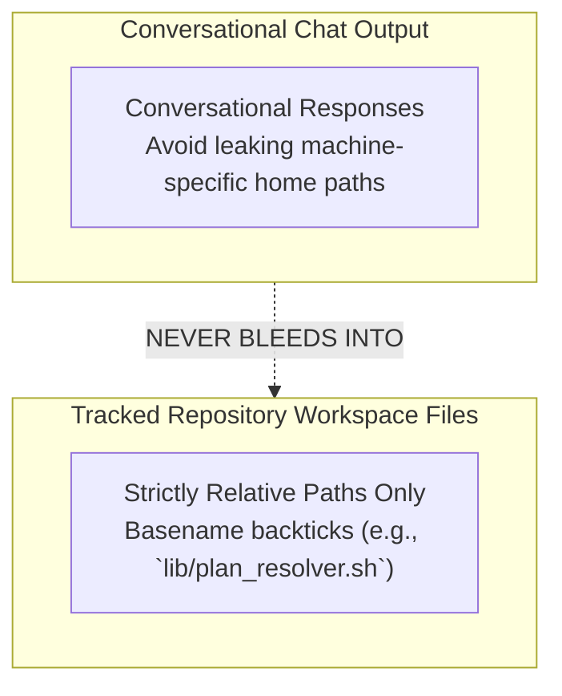

# 🤖 Agent Skills & Slash Commands Reference

AAPP equips autonomous coding assistants (Claude Code, Google Antigravity, Cursor, Codex, OpenCode) with high-discipline planning skills. These skills mirror the CLI capabilities while enforcing strict blast-radius isolation, atomic worktree commits, and failure-first TDD methodology.

---

## 1. Universal Skills Catalog

The system distributes 13 standardized skills under `.agents/skills/` (and synchronizes with platform-specific directories such as `.claude/skills/`):

| Skill Name | Canonical Path | Primary Responsibility |
| :--- | :--- | :--- |
| **`aapp`** | `.agents/skills/aapp/SKILL.md` | Session initialization, rules loading, and 4-pillar recovery briefing. |
| **`aapp-plan`** | `.agents/skills/aapp-plan/SKILL.md` | Canonical blueprint planning in `.plans/current/` (replaces scratchpads). |
| **`aapp-digest`** | `.agents/skills/aapp-digest/SKILL.md` | Digests ideas from `pickup.md` or issues from `ISSUES.md` into blueprints. |
| **`aapp-freeze`** | `.agents/skills/aapp-freeze/SKILL.md` | Design lock and greenlight authorization (`🔷 Ready for Execution`). |
| **`aapp-start`** | `.agents/skills/aapp-start/SKILL.md` | Plan activation (`⚡ In Development`), disjointness audit, buffer binding. |
| **`aapp-commit`** | `.agents/skills/aapp-commit/SKILL.md` | Plan-bound commit helper with attribution trailers and SHA recording. |
| **`aapp-done`** | `.agents/skills/aapp-done/SKILL.md` | Post-implementation verification, archive relocation, matrix cleanup. |
| **`aapp-fix`** | `.agents/skills/aapp-fix/SKILL.md` | Worktree-isolated mini-plan execution for queued bug fixes (`#<num>`). |
| **`aapp-status`** | `.agents/skills/aapp-status/SKILL.md` | Morning recovery briefing scanning Shipped, Issues, Plans, and Pickup. |
| **`aapp-release`** | `.agents/skills/aapp-release/SKILL.md` | Milestone release orchestrator with preflight verification and bundling. |
| **`aapp-pause`** | `.agents/skills/aapp-pause/SKILL.md` | Emergency brake: halts writes and stashes active uncommitted work. |
| **`aapp-tdd`** | `.agents/skills/aapp-tdd/SKILL.md` | Injects failure-first test specifications into §3 and §4 before freeze. |
| **`aapp-hooks`** | `.agents/skills/aapp-hooks/SKILL.md` | Validates, hashes, and dispatches extensible lifecycle events. |

---

## 2. Slash Commands & UI Dispatch

Agents and developers interact with skills using slash commands in chat interfaces. Slash commands resolve seamlessly to CLI actions or internal tool operations:

```text
Chat UI Input         Skill Trigger              CLI Action
-------------         -------------              ----------
/aapp                 aapp/SKILL.md              aapp status
/aapp-plan [slug]     aapp-plan/SKILL.md         aapp draft <slug>
/aapp-digest [id]     aapp-digest/SKILL.md       aapp draft <slug> issue <id>
/aapp-freeze <id>     aapp-freeze/SKILL.md       aapp freeze <id>
/aapp-start <id>      aapp-start/SKILL.md        aapp start <id>
/aapp-done <id>       aapp-done/SKILL.md         aapp done <id>
/aapp-fix #<num>      aapp-fix/SKILL.md          aapp issue fix <num>
/aapp-release <ver>   aapp-release/SKILL.md      aapp release <ver>
/aapp-pause [reason]  aapp-pause/SKILL.md        aapp pause [reason]
/aapp-tdd <id>        aapp-tdd/SKILL.md          aapp tdd <id>
```

---

## 3. Chat vs. Workspace Boundary Invariant

To maintain repository portability across diverse developer environments and continuous integration runners, AAPP enforces a strict boundary between chat interactions and workspace storage:



### The Invariant Rules
1. **Relative Paths Invariant**: All repository files, plans, commit messages, and documentation must use repository-relative paths (e.g. `docs/reference/...`) or backticked basenames.
2. **Zero Machine Path Leaks**: Machine-specific absolute home directories (`/home/...`, `/Users/...`, `C:\...`) and absolute file URI schemes are strictly prohibited from tracked files to guarantee portability across developer environments.
3. **Mechanical Guard**: The pre-commit hook scans all staged content for machine-specific paths and absolute schemes. Any occurrence causes immediate commit refusal.

---

## 4. Human-in-the-Loop Governance & Autonomy Guardrails

AAPP balances AI agent speed with strict architectural control:

- **Free Drafting**: Agents may freely draft incubator blueprints (`📝 Refining`) to explore solutions or digest pickup ideas. Drafting incurs no risk and confers no code execution authority.
- **Human Greenlight**: A blueprint can only transition to `🔷 Ready for Execution` via human sign-off (`aapp freeze`). The human verifies that Section 2 (Technical Blueprint) and Section 4 (Blast Radius) are sound.
- **Fail-Closed Execution**: Once an agent begins execution (`⚡ In Development`), it is mechanically trapped within the declared `### 📂 Target Files`. Any tool call or shell write attempting to modify out-of-scope files is aborted.
- **Immutable Historical Records**: Agents may never rewrite closed issue logs or historical changelogs. Closed rows are strictly appended to archive ledgers without prose modification.

---

## 🧭 Continuous Navigation
- 📖 [Technical Manual](../../MANUAL.md)
- 💻 [CLI Verb Reference](02-cli-commands-and-verbs.md)
- 🏠 [Repository Overview](../../README.md)
